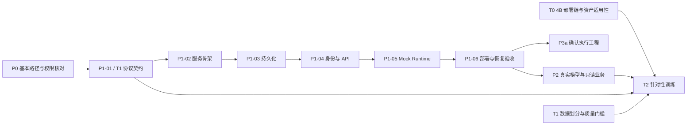

# P1 开发计划：可恢复的 Agent 运行骨架

日期：实施记录 2026-10-08；P1-05 主会话终审 2026-10-09；P1-06 与 P1-04 真实 Auth 补验收 2026-10-10（Asia/Shanghai）  
状态：P1-01 至 P1-06 限定范围已完成；主会话于 2026-10-10 已批准 P1 整体证据终审通过（`PASSED_LIMITED_P1_ENGINEERING`）。A01–A11 无阻塞项；批准范围与限制见[终审报告](FINAL_REVIEW.md)。P1-04 真实本地 Auth 补验收与 P1-06 Docker 验收的阶段证据仍按历史原文存档。
目标：依据 v0.4.2 指南，以确定性 Mock 验证服务、身份隔离、持久化、状态机与恢复；T0 六步部署链已按当前 T0 记录完成，不作为模型业务质量结论。

## 1. 当前进度与证据

| 对象 | 本次核对结果 | 阶段判断 |
|---|---|---|
| 业务工作区 | `D:/project/Android/shared-ledger`，`main@3f938ee6114b763e6cd3dbd10792a78c691eb526`；本次读取时工作区 clean | 当前业务实现依据 |
| Agent 工作区 | `D:/project/Android/shared-ledger-agent`，`agent@1a80a0f29e1ea432a60b95e7437af23d51182938`；用户确认 `1a80a0f` 已提交并推送，本地 `origin/agent` tracking ref 与 HEAD 一致；commit 仅含 16 个 T0/shared 文档、不含 P1。P1 源码与本次文档为未跟踪/未暂存；首轮错误路径的两份候选文档已移入本 checkout | P1 限定工程范围经主会话终审通过；完整证据见[终审报告](FINAL_REVIEW.md) |
| P0 | CAP01–17 的真实入口、参数、角色、版本与缺口已有映射 | P0 工程核查按当前状态记录已通过；这不代表所有 CAP 已完成端到端验证 |
| 业务验证 | 既有审计记录：32 SQL 文件 / 237 pgTAP assertions、Android 268 tests 与 assembleDebug 通过；本会话未重跑 | 证明所记录业务验证范围，不代表 Agent 能力通过 |
| T0 | 当前 [T0 清单](../t0/README.md)记录六步部署链于 2026-10-08 完成，含 4B Q4_K_M host/Docker smoke、生命周期与日志归档 | 仅证明记录所述部署链和资源检查通过；不证明模型账务语义质量、Teacher 可用性或训练数据适用性 |
| 模型环境 | 既有 9B 原生 API host/Docker 合成请求非空；T0 4B 部署链已通过；兼容 chat/completions 在所测配置下为空 | 部署连通不替代模型质量验收；兼容接口诊断归 P2 |
| Teacher / 训练 | OpenCode Go / DeepSeek Flash 的静态路由已核对，completion 尚未验证；旧模型仍有提案路由、参数和事实问题 | P1-01 的 API/语义/工具/轨迹协议及版本 manifest 已冻结；正式 T1 数据集与质量门槛仍未冻结，新版 T2 训练尚未启动 |
| P1 / P3 / P4 | P1-01 至 P1-06 已按限定范围完成，整体 P1 已由主会话于 2026-10-10 批准通过；生产 Scope、真实模型推理、业务写入与 Android Agent UI 尚未完成 | 仅确认 P1 限定工程门；真实自然过期 JWT 为 NOT_TESTED，Vector 重启为有界例外；P3/P4 与模型/业务质量不得推定通过 |

Agent checkout 的 `app/`、`supabase/`、`docs/backend/` 是旧业务基线。核对业务规则时读取 main 工作区；本阶段无需为搭骨架先合并整套业务变更。

本次进度判断以 Git、文件与最新阶段审查共同为依据。共享文档的旧状态文字和旧 HEAD 不作为当前代码状态；本计划也不代替 P0 的正式收尾记录。

## 2. P1 范围和并行关系

P1 交付 Python + FastAPI + Pydantic 单服务、SQLite 持久化、身份与会话隔离、版本化协议、受限 Runtime、MockModelProvider、Docker/Compose 和操作说明。采用指南中的单应用 worker，模型并发初值为 1。

P1 接收结构化页面线索，但不把客户端自报 actor、role、成员身份或实体 ID 当成授权事实。MockBackendAdapter 的规则与结果必须显式标为模拟；真实业务 DTO、权限与对象绑定联调归 P2。

P1 保留写提议、待确认和未来执行恢复的协议边界。业务执行适配器默认不可用；确认接口在未启用执行能力时返回明确错误，不生成成功业务回执。仅在隔离测试中注入执行状态和模拟回执验证恢复分支。P3a 再交付完整的可信预览、确认和执行链。



已记录通过的 T0 部署链不阻塞 P1 的 Mock 实现，也不替代模型质量评估。P1 先完成 T1 中的 API/语义/工具/轨迹契约，后续 T1 结合 P2 基线冻结正式训练数据、业务状态划分和质量门槛；协议快照完成不等于整个 T1 完成。T2 前仍需核实 Teacher 可用性、T1 数据及 P2 基线证据。

P1 不接真实 LM Studio 推理，不开展训练，不开放真实业务写入。云端 receipt/close_execution 与版本保护归 P3；Android UI 归 P4，且需先通过 P3b+T3 联合门。

## 3. 六批开发任务

每批完成后记录文件、检查命令、实际结果和下一步。按依赖顺序推进，普通可逆实现问题在阶段内解决。

| 批次 | 工作 | 交付物 | 进入下一批的条件 |
|---|---|---|---|
| P1-01 · 协议与 T1 契约 | 定义 answer/clarify/read/propose；API 请求、状态、事件、UI context；操作注册表；请求去重及恢复约束；区分模型语义与正式 RPC 命令 | Pydantic 协议源、JSON Schema / OpenAPI 快照、版本 manifest 与 SHA-256、最小 Mock 轨迹 | 四类正向用例通过；写调用、自报确认、未知字段/操作、错误金额格式被拒；API/语义/操作/轨迹版本关系明确 |
| P1-02 · 服务骨架 | 独立依赖和锁文件；配置；lifespan；API/Runtime/Store/Provider/Adapter 装配；存活、存储就绪和 provider 状态 | `agent/` 工程入口、配置模板、health/readiness、宿主启动命令 | 不依赖 LM Studio 可启动；缺配置给明确错误；单 worker；启动失败不会虚报 ready |
| P1-03 · 持久化 | 四张业务表及技术迁移记录；短事务；状态和事件原子保存；唯一请求键；持久引用；条件状态更新与恢复扫描 | SQLite migrations、AgentStore、故障注入与重启测试 | 返回 202 前输入已提交；同键重试不新增；同键不同正文拒绝；断电/进程终止后状态与事件一致 |
| P1-04 · 身份与 API | 验证 Supabase 身份；会话归属；按操作授权边界；提交、轮询、resume、cancel；确认路由执行能力关闭；分页、payload 上限、基本限流 | 版本化 API、AuthVerifier、ScopeAuthorizer 接口、两账号 API 用例；范围证据见 [身份与 API 交接](IDENTITY_API.md) | 主会话确认代码与本地模拟授权范围通过；2026-10-10 本地真实 Auth 正向 smoke 与 A/B session owner 隔离通过，29 项实际检查见[报告](REAL_AUTH_SMOKE.md)及[脱敏证据](evidence/P1-04-RealAuthSmoke-20261010-013323.json)。真实 Auth-issued expired-token smoke 明确 NOT_TESTED；生产 Scope/preparer 仍 fail-closed。此前 seed 用户的 NULL `confirmation_token`/HTTP 500 为历史上游问题，未修改该用户或修复上游。 |
| P1-05 · Mock Runtime | 确定性四语义解析、受限 read、认证/澄清恢复、模拟提案调整、调度与资源边界；Runtime.close 迟到 claim 和 Store.close 清理有确定性回归覆盖 | `app/harness.py`, `app/runtime.py`, `app/backend.py`, `app/store.py`, `app/api.py`, `tests/test_mock_runtime.py`, `tests/test_mock_runtime_api.py`, [Mock Runtime 交接](MOCK_RUNTIME.md) | 2026-10-09 主会话终审：该批次限定全量 `115 passed in 23.52s`（核心 21、API 10、历史 84）；此前主会话的后续全量记录为 `126 passed in 26.48s`（含 11 项备份恢复测试），这两项是历史测试结果，本次 Docker 续验没有重跑 Python 全量测试，不改变 P1-05 历史结果；`export_contracts --check` manifest matches；`uv lock --check --offline --project agent` 检查 32 packages / exit 0；不据此验收真实业务读写或模型能力 |
| P1-06 · 部署与验收 | Dockerfile、Compose 持久卷、启停/状态/备份/恢复/验收脚本；SQLite 备份模块与测试；协议漂移门；[部署与恢复报告](DEPLOYMENT_RECOVERY.md)、[宿主/静态证据](evidence/P1-06-HostStatic-20261009.json)、[2026-10-09 Docker 预检历史](evidence/P1-06-Docker-20261009-114423-637306fb1414.json)及[2026-10-10 最终 Docker 实测](evidence/P1-06-Docker-20261010-004731-c10d607729c2.json) | deploy/、备份恢复 helper、报告与脱敏证据 | 2026-10-10 限定 Mock 部署/恢复验收 PASS：普通生产入口、关闭门、合同漂移检查、在线备份、stop/start、干净新卷恢复、recreate、DB/日志扫描及资源比较通过。Docker A10 使用本地模拟身份；真实 Supabase Auth 由 P1-04 单独补验收并通过，生产 Scope、模型推理和业务写入仍未验证/启用。 |

P1-01 先冻结最小但完整的语义与操作 Schema。首批 Mock 场景聚焦活动/消费/债务读取，以及新增消费和允许的消费修改提议；CAP01–17 的完整目录和分阶段实现状态持续可追踪，未实现项显式 unavailable，不因注册工具名称就声称支持。

## 4. 最小工程结构

```text
agent/
├─ app/
│  ├─ main.py / settings.py
│  ├─ api.py / contracts.py
│  ├─ auth.py / context.py
│  ├─ runtime.py / model.py
│  ├─ backend.py / gateway.py / store.py
│  └─ operations/
├─ contracts/           # 新协议源的导出快照、版本与 manifest
├─ migrations/          # 本地 SQLite 迁移
├─ tests/               # 协议、隔离、去重和故障恢复
├─ deploy/              # Docker、Compose、PowerShell 脚本
├─ docs/p1/             # 计划、验收证据索引与续接记录
├─ pyproject.toml / 依赖锁文件
└─ .env.example
```

旧 `docs/ai/schema/`、训练数据、checkpoint、离线报告保留原版本。新语义协议不导入旧六类输出或 D4 一律禁用标签作为当前实现规则。

## 5. 必须先定的契约

### 身份、上下文与权限

- actor 只来自有效认证结果，不接受请求正文自报。逐端点检查资源归属；读取缓存的会话/提案前仍按当前权限过滤活动相关内容。
- Supabase 校验路径在实现时根据项目签名方式选择：非对称签名可用 JWKS 验签；HS256 按官方建议通过 Auth `/user` 校验。不能仅解码 JWT；不在源码里保存密钥。[官方 JWT 文档](https://supabase.com/docs/guides/auth/jwts)
- access token 只在内存短期使用，通过 Authorization 提交，不进 SQLite、事件、日志或模型上下文；不保存 refresh token。服务重启后需要身份的工作等待客户端重新授权。
- 创建/加入操作不要求预先是活动成员；已有活动查账和修改采用各自权限。P1 用授权夹具验证分流，真实业务链路在 P2/P3 验收。
- P1 的 agent_enabled/disable_revision 采用明确的测试偏好来源验证控制分流；云端偏好存储、跨设备开关一致性归后续阶段，不能由客户端布尔值自证。

### 四表、请求键与事件

| 表 | 关键内容与不变量 |
|---|---|
| sessions | owner_user_id、默认可空 scope、标题与时间；归属不可由客户端换写 |
| turns | 输入、state/step/wait_reason/resume_state、上下文版本、类型化引用、execution_id；同一 actor 的 client_request_id 唯一；相同键比较规范化 payload hash |
| events | turn_id、单调 seq、类型与有限 payload；同一次事务写状态与事件；持久 proposal 事件只存引用 |
| proposals | actor/session/turn、revision、command/preview/preconditions、digest、nonce、policy_version、status、expires_at、execution_id；一个会话至多一个待确认写提案 |

resume 的澄清/认证输入也必须具有 request_id 去重语义。P1-01 明确如何在四表内保存去重记录和原响应，不能只对首次 turns 提交去重。请求已提交但 HTTP 响应丢失后，重试仍返回原任务；数据库失败时不得返回“已接收”。

nonce 保存在 proposals，API 在归属与权限校验后补齐当前卡片；不存进普通事件、日志或模型。相同 revision 轮询返回同一 nonce，失效/被替换/终结时不返回可确认 nonce。命令 digest 绑定参数、前提和协议/策略版本，执行正文不来自客户端提交的 digest。

### 状态与恢复

| 状态/情况 | P1 实现要求 |
|---|---|
| QUEUED | 输入已经落库；以数据库状态和入队时间调度 |
| RUNNING | 可中断的模型/读取过程；重启按检查点重新推进只读步骤，避免重复事件 |
| WAIT_INPUT | 区分 missing_fields/auth_required；保存 resume_state；刷新凭证后恢复原阶段 |
| WAIT_CONFIRM | 持久提案，检查有效期与关闭修订；重启、轮询、普通查询均不自动确认或替换 |
| EXECUTING / RECOVERING | P1 保留契约并以隔离夹具验证：有 execution_id 先核对原结果，不回模型、不换键；真实 receipt/close_execution 实现留 P3 |
| COMPLETED / CANCELLED / FAILED | 原终态可回读；未知执行结果不能写成 FAILED；取消后的迟到模型输出不能改变终态 |

确认/调整/取消对同一 Proposal 使用条件更新。参数改变生成新 revision，普通网络重试不生成新版本；提案一旦已有 execution_id 不再调整命令。稳定执行键绑定用户、proposal_id、revision，设计时兼顾重启与旧备份，不依赖仅存于本机的随机执行编号；真实云端幂等仍须 P3 单独验证。

初始资源约束沿用指南：模型并发 1；每用户至多 1 个运行和 1 个排队任务；全局排队上限 16；一次自动推进至多 6 次模型调用、4 次读取、1 次结构修正；提案有效期 10 分钟。等待用户的任务不占执行/排队名额；限流与超时必须可配置、可观测。

关闭 Agent 拦截新输入、继续规划和首次确认，但本人已有结果核对、补认证和取消仍可用。模型不可用不阻止服务启动和恢复 API。取消不依赖停止模型请求成功，必须通过持久状态忽略迟到输出。

## 6. P1 必测清单与验收边界

| 编号 | 必测动作与期望 | 指南对应 |
|---|---|---|
| P1-A01 | 两账号互访 sessions/turns/proposals 的 list/get/resume/cancel/confirm 均隔离；伪造 actor/role/页面 scope 无效 | R07、R14；业务访问使用夹具，真实业务授权留 P2 |
| P1-A02 | 相同请求并发/响应丢失后重试返回同一 Turn；同键不同文本或 context 拒绝；resume 重试不重复追加 | R12、R15 的输入去重 |
| P1-A03 | QUEUED、RUNNING、WAIT_INPUT、WAIT_CONFIRM 各阶段终止进程后恢复；状态和事件一致，待确认不执行 | R10 的 P1 部分 |
| P1-A04 | token 缺失/过期暂停；刷新恢复正确阶段；注入 execution_id 的任务保持原键核对，不回模型 | R14、R15；执行仅模拟 |
| P1-A05 | 类型化引用经过结果重排、澄清、重启仍指向原对象；跨 Turn 不按同名编号复用 | R19 |
| P1-A06 | 查询不覆盖待确认提案；调整/取消条件竞争仅一个成功；旧 revision/nonce、过期、他人确认拒绝；执行关闭时无业务成功回执 | R01、R02、R20 的本地部分 |
| P1-A07 | 模型迟到、超时、非法输出、调用上限、队列满都产生可追踪状态；无无限循环；取消后迟到结果被丢弃 | R11、R13 |
| P1-A08 | 关闭后允许本人恢复/取消，拒绝新规划与确认；重开后旧关闭修订的提案失效 | R09、R16；使用偏好夹具 |
| P1-A09 | 持久事件/模型输入/日志中无 token、refresh token、confirmation_nonce；无真实业务写适配器入口 | 协议与确认边界 |
| P1-A10 | stop/start/recreate 保留 SQLite；一致性备份在干净目录恢复；provider/Agent disabled 时仍能查看状态、补认证和取消；实际结果见[最终 Docker 验收证据](evidence/P1-06-Docker-20261010-004731-c10d607729c2.json)及[部署与恢复报告](DEPLOYMENT_RECOVERY.md) | O01、O02、O04 的 P1 部分；2026-10-10 限定 Mock 的真实容器 A10 验收通过，不证明真实 Supabase 身份、模型推理或业务读写 |
| P1-A11 | P1-01 离线协议源、四类语义、最小轨迹、非法字段/操作/金额等静态拒绝用例已测；旧六类/真实服务边界未作运行验收 | T1 契约与 R01；仅记录 P1-01 离线范围 |

每项保存环境、代码 commit/未提交范围、输入/期望/实际、结果和日志路径。隔离测试数据标记 simulation，不把模型语义正确、权限夹具通过和真实后端执行混为一个指标。

P1 通过条件：服务可启动，四表与协议有版本，所有上述必测项通过，Mock query/clarify/propose 可恢复，两账号隔离，重建容器不丢状态，真实业务写能力关闭。真实账务原子性、执行与 close_execution 竞态、旧备份与云端 receipt 对账、全部 CAP 和实际模型工具质量均属后续验收，不能提前写 PASS。

## 7. 与 T0 会话的协作及后续步骤

- 本会话拥有 `agent/` 的新服务、`contracts/`、`migrations/`、`tests/`、`deploy/` 和 `docs/p1/`；T0 继续负责外部模型工具/产物及 `docs/p0/t0-assets-and-lessons.md`、环境证据。
- 本阶段只改 P1 自有代码、配置、测试和文档，未改共享 `dev-status.md`、P0 目录或统一指南。后续由明确负责人统一 P0 收尾、HEAD 和阶段状态；同时写共享文档前先检查最新 diff。
- 已完成的 T0 清单与报告向 P2/T2 提供部署路径、实际模型 ID/格式/量化/上下文、工具版本、资产 hash 和资源约束；Teacher 实际可用性及模型业务质量仍属独立验证。P1 不启动/卸载模型或占用训练 GPU。
- 每批采用小范围、可验证的变更。提交前核对 `git status` 和 staged diff，只包含本批文件；不能顺手提交另一会话的修改。
- P1 完成后转 P2 的真实只读及未训练基线，同时具备 P3a 工程准备条件；真实写保护必须解决 Expense update 无调用方 CAS 的已知缺口，保持原 App LWW。

最终状态（主会话批准，2026-10-10）：P1 按已定义的可恢复 Agent 骨架、Mock Runtime、身份隔离（含本地真实 Auth 正向验收）和 Docker 部署/备份恢复通过，A01–A11 无阻塞项。实际全量测试 126 passed in 34.25s（本次实跑）；历史 126/26.48s 与 115/23.52s 仍分别记录。真实 Auth-issued 自然过期 token 未测；Docker Vector 既有 restarting 容器的 `preexisting_state_unchanged=false` 为有界例外。用户确认 T0 六步完成并推送 `1a80a0f`；本地 HEAD/origin/agent tracking ref 一致，提交不含 P1。P1-01 协议已冻结，整个 T1 数据集和质量门槛仍未完成冻结/验收。本状态不启动 P2。

## 依据

- [统一开发指南 v0.4.2](../shared-ledger-agent-development-guide-v0.4.html)：P1、components、state、protocol、packaging 与 R/O 用例。
- [Agent 开发状态](../dev-status.md)、[P0 工程审计](../p0/engineering-audit.md)、[CAP 能力映射](../p0/capability-map.md)、[T0 资产与教训](../p0/t0-assets-and-lessons.md)。
- [总体开发流程](../development-workflow.md)：P/T 依赖；其中旧 HEAD 和 P0 阻塞措辞需按最新阶段审查收尾。
- [当前业务基线](D:/project/Android/shared-ledger/docs/backend/BUSINESS_LOGIC.md)、[大型活动预存补充规则](D:/project/Android/shared-ledger/docs/ai/PREPAYMENT_LARGE_ACTIVITY_RULE_2026-10-06.md)。
- 当前 T0 部署链状态及范围引用 [Agent README](../../README.md) 与 [T0 清单](../t0/README.md)；部署验证不扩展为模型语义或业务质量结论。

## 主会话整体终审

主会话已批准本计划中 P1 限定工程范围通过：可恢复 Agent 骨架、Mock Runtime、身份隔离与本地真实 Auth 正向证据、Docker 部署和备份恢复；A01–A11 无阻塞缺口。本次结论仅属 `PASSED_LIMITED_P1_ENGINEERING`，不代表生产 Scope、真实模型质量、业务写入或完整 T1 通过。用户确认 T0 六步已完成并推送 `1a80a0f`；本地 `origin/agent` 与 HEAD 一致，该提交不包含 P1。P1-01 的 API/语义/工具/轨迹协议与版本 manifest 已冻结；train/validation/sealed 数据集冻结、旧标签重标、Teacher availability 与正式质量门槛仍需独立验收。完整追溯表和限制见[终审报告](FINAL_REVIEW.md)。
